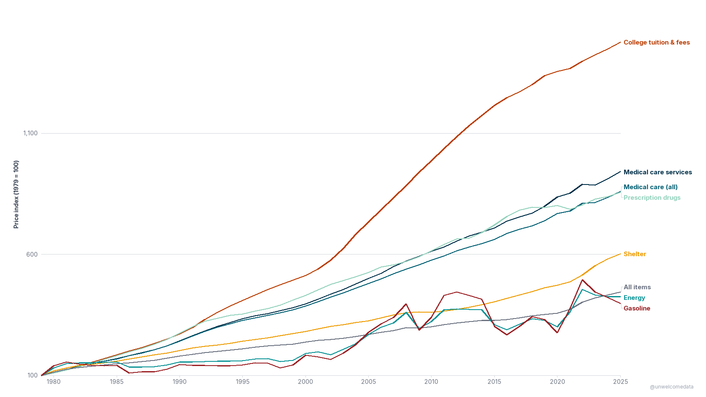
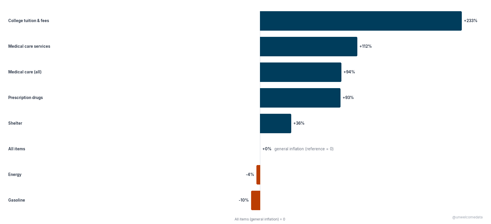
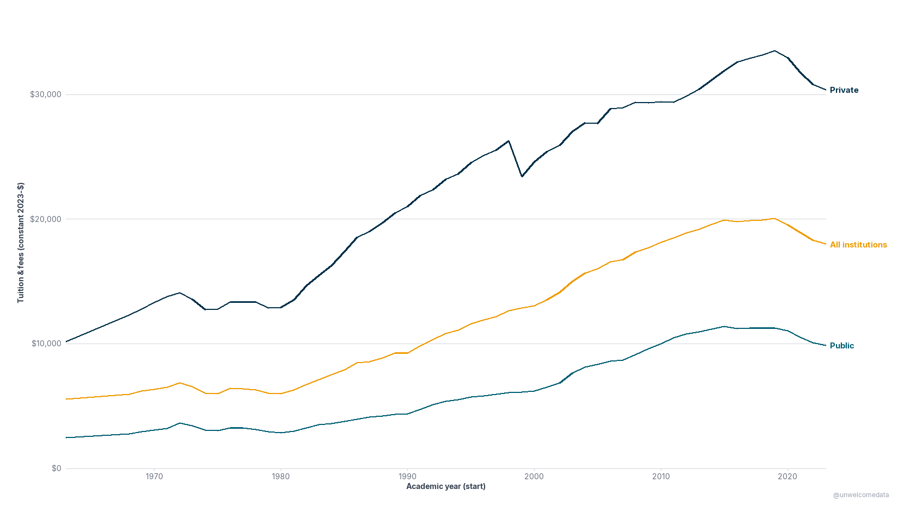
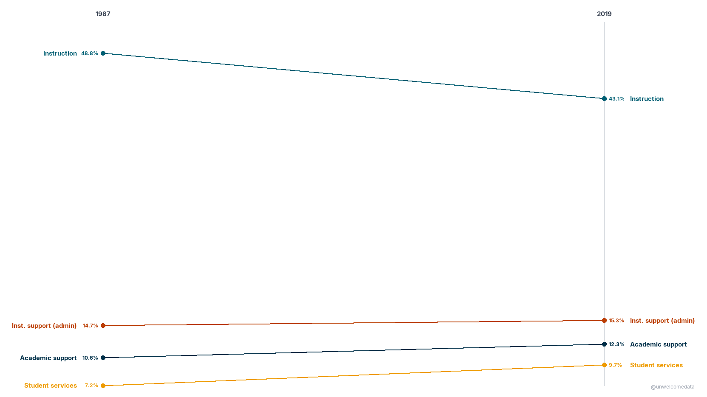

**[@unwelcomedata](https://github.com/unwelcomedata)** · data from public sources

# We say "Big Pharma" and "Big Oil." Why not "Big Education"?

Since 1979, the price of college has out-run **general inflation** and **every
other "big" sector** people complain about — healthcare, prescription drugs,
housing, even oil and energy. College tuition & fees rose roughly **fourteen times**
over since 1979, versus about **four and a half times** for prices overall. On the
sticker-price measure that drives the "unaffordable college" conversation, higher
education is the steepest cost line in the economy — yet it never gets the "big
industry" branding the others do.

This project builds that comparison from U.S. federal, public-domain data: BLS
Consumer Price Index sector sub-indices, the NCES Digest of Education Statistics,
and the NCES Delta Cost Project + IPEDS finance records. It also asks the honest
follow-up — *where does the money go?* — and reports what the data actually
supports, not the easy headline.

**The findings that held up:**

- **Tuition is the steepest sector.** Re-indexed so 1979 = 100, college tuition &
  fees reaches ≈ **1,477** by 2025 — above medical-care services (≈ 942) and roughly
  **3× general inflation** (All Items ≈ 443).
- **It out-ran general inflation by more than any other sector — ≈ +233%.** Measured
  against All Items (the zero baseline), tuition beat general inflation by about
  233 percentage points; medical-care services by ≈ +112%. Gasoline (≈ −10%) and
  energy (≈ −4%) actually *lagged* inflation over the full window.
- **In real dollars, public 4-year tuition roughly quadrupled** — from ≈ $2,442
  (1963-64) to ≈ $9,872 (latest), in constant dollars, i.e. after inflation.
- **The money shifted away from the classroom — but it's not "administrators
  alone."** Instruction's share of core spending fell (≈ 48.8% → 43.1%) while
  *non-instructional* spending rose (≈ 32.5% → 37.4%). The honest part:
  **institutional support (the IPEDS "admin" line) is roughly flat (≈ 15%)** — the
  growth is in student services and academic support. "Non-instructional outgrew
  instruction" is defensible; "administrators alone exploded" is not what this data
  says.

---

## The charts

_Click any chart to open it full size. CPI figures are BLS CPI-U, U.S. city
average, not seasonally adjusted, annual averages._

**We say "Big Pharma" and "Big Oil." Why not "Big Education"?** Every CPI sector
re-indexed so **1979 = 100** — a line's height is the cumulative price rise since
1979 (400 means prices quadrupled). The window **starts in 1979** because that's
where the BLS college-tuition sub-index begins (December 1978); every sector is
truncated to that common base. College tuition & fees is the steepest line by a
wide margin, far above the medical-care and energy lines.

[](docs/01_big_education_indexed.png)

**How much each sector out-ran general inflation, 1979 → latest.** Each sector's
cumulative price change *relative to All Items* — so **All Items = 0** is the
zero baseline, bars to the right beat general inflation, bars to the left lagged
it. College tuition & fees is the largest positive bar at **≈ +233%**; gasoline and
energy sit below zero (they *lagged* general inflation over this long window).

[](docs/02_outran_inflation_diverging.png)

**Published undergraduate tuition & fees, 1963-64 → latest, in constant dollars.**
Real (inflation-adjusted) sticker tuition at 4-year institutions, one line per
control. The dollars are **constant** — the ≈ 4× climb for public 4-year
(≈ $2,442 → ≈ $9,872) is *real* growth, not just inflation. **Private is the top
line.** These are **published (sticker) prices, not net of grant aid**, and real
prices have **flattened/softened in the most recent years**.

[](docs/03_tuition_since_1963.png)

**Where the money goes: core spending mix, 1987 → latest.** Share of core
functional spending nationally — **instruction** vs the three non-instructional
functions (institutional support = admin, academic support, student services).
Instruction's share **fell** (≈ 48.8% → 43.1%) and non-instructional **rose**
(≈ 32.5% → 37.4%) — **but institutional support (admin) alone is roughly flat
(≈ 14.7% → 15.3%)**. The honest read is "non-instructional spending outgrew
instruction," *not* "administrators alone exploded." The series stitches the Delta
Cost Project (1987–2012) to the IPEDS finance tail (2013+) with a **seam at 2012**.

[](docs/04_spending_mix.png)

---

## How it was measured

The thesis is **relative to inflation**, deliberately: nominal tuition always rises,
so "college got more expensive" is trivially true and uninformative. The question
worth asking is whether tuition out-paced *general* inflation and the *other* big
cost sectors — so every comparison here is indexed to a common base (1979 = 100) or
expressed in constant (inflation-adjusted) dollars.

- **Relative-inflation sector comparison (charts 1 & 2)** uses BLS CPI-U sector
  sub-indices (U.S. city average, not seasonally adjusted, annual averages),
  re-indexed to 1979 = 100 and compared against All Items (general inflation).
- **The long tuition series (chart 3)** is NCES Digest Table 330.10, in NCES's own
  constant dollars (CPI-U All-Items deflated).
- **The spending mix (chart 4)** uses the NCES Delta Cost Project (1987–2012) spliced
  to raw IPEDS finance (2013+), as *shares* of core functional spending.

**Caveats that materially affect interpretation:**

1. **Sticker price, not net of aid.** The CPI tuition sub-index (charts 1 & 2) and
   the published tuition in chart 3 track *charged / sticker* price, **not** the net
   price students pay after grants and scholarships. Net price has risen more slowly
   than sticker price, so these charts describe the *list* price, not the typical
   out-of-pocket cost.
2. **"Admin" is a definitional choice.** Chart 4's "admin" is **IPEDS institutional
   support only** — a specific accounting category. Different definitions of
   administration yield different "bloat" magnitudes: **microdata analyses of
   administrator headcount (e.g. FIRE / Kay & Honeycutt, 2025) find *more* admin
   growth than the IPEDS spending-share accounting shows.** So "admin spending share
   is roughly flat" is true *for this accounting measure* and does not contradict
   headcount-based findings that administrators grew faster than faculty. The four
   core categories: **instruction** (teaching — faculty, departments, instructional
   activity); **institutional support** = admin (executive management, general
   administration, finance, HR, legal); **academic support** (libraries, academic
   computing, deans' offices, curriculum support); **student services** (admissions,
   registrar, financial-aid administration, counseling, student activities).
3. **Energy and gasoline are volatile.** Oil-linked prices swing sharply year to
   year, so a long-window *cumulative* comparison understates their short-run spikes
   — gasoline can be far above inflation in a given year even though it *lagged*
   inflation across the full 1979 → present window.
4. **2025 figures are preliminary.** The CPI series runs into mid/late 2025, and
   2025 annual averages are still subject to minor revision by BLS.

Per-source collection methods, definitions, series breaks (GASB vs FASB accounting,
the 2012 Delta→IPEDS seam, the 2012-13 IPEDS HR occupational-category break), and
known controversies are documented in [SOURCES.md](SOURCES.md).

---

## The data

The published datasets are in [`export/`](export/):

- `higher_education_cost_cpi_sectors_v1.csv` — CPI-U sector sub-indices re-indexed to
  1979 = 100 (the data behind charts 1 & 2).
- `higher_education_cost_tuition_longrun_v1.csv` — constant-dollar published tuition &
  fees by control and level, 1963-64 → latest (chart 3).
- `higher_education_cost_spending_mix_v1.csv` — national share of core functional
  spending by year, 1987 → latest (chart 4).
- A `*_codebook.md` accompanies each dataset with a plain-English description of
  every column.

The richer packaging (Excel, Parquet), a combined institution-level dataset, and the
full pipeline code are in the repo.

---

## Reproduce it

The published datasets rebuild from raw sources with one command:

```bash
python scripts/reproduce.py
```

It runs the full pipeline — **ingest → load → clean → prepare** — using the same
logic the project uses throughout (in [`src/`](src/): `ingest.py`,
`clean_quality.py`, `prepare.py`). On the first run it downloads the BLS CPI-U
sector series, the NCES Digest tuition table, and the NCES Delta Cost Project +
IPEDS finance files (the URLs are in [SOURCES.md](SOURCES.md)) into `data/raw/`;
after that it runs offline. See [`scripts/README.md`](scripts/README.md) for the
run order, options, and the stage-by-stage breakdown, and
[`scripts/validate_charts.py`](scripts/validate_charts.py) for the pre-publish gate
that re-derives every headline figure in the four charts straight from the database.

---

## Sources & license

Full attribution — publisher, URL, collection method, definitions, series breaks,
and known controversies — is in [SOURCES.md](SOURCES.md). In short: BLS Consumer
Price Index (CPI-U), the NCES Digest of Education Statistics (Table 330.10), and the
NCES Delta Cost Project + IPEDS finance and tuition records — all U.S. government
works in the public domain. No crowd-edited sources are used.

---

## Further exploration

- **Administrator vs faculty headcount** (IPEDS Human Resources, 2013 → present) —
  the complementary "bloat" cut, where administrators *did* outpace faculty and
  enrollment. Headcount (a count of people) tells a different story than spending
  share (a split of dollars); both belong in the picture.
- **Per-state admin spending** — how the admin-vs-classroom split varies across
  states and institution control.
- **Net price vs sticker price** — layering College Scorecard net-price data on top
  of the sticker series to show what students actually pay after aid.

---

> **AI-Assisted Development**
> This project was built with the assistance of [Kiro](https://kiro.dev), an
> AI-powered development environment. All data-sourcing decisions, methodology
> choices, and published findings are the responsibility of the author. AI was
> used for code generation, data-pipeline construction, and research assistance —
> not for analysis conclusions or editorial judgment.
